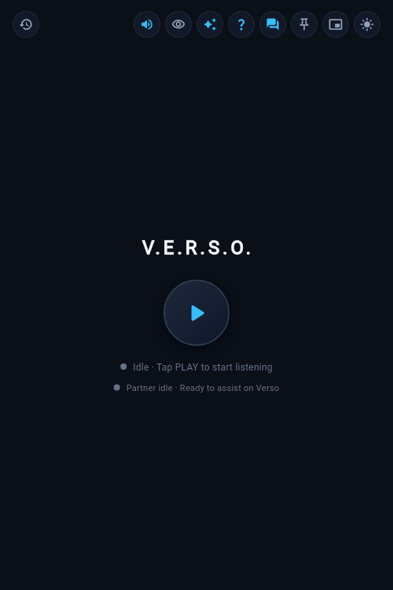
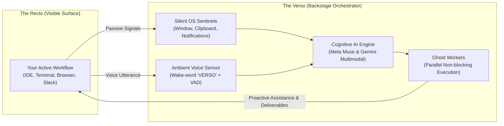
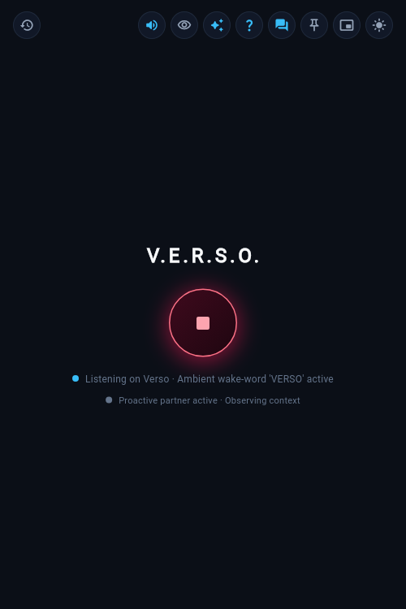
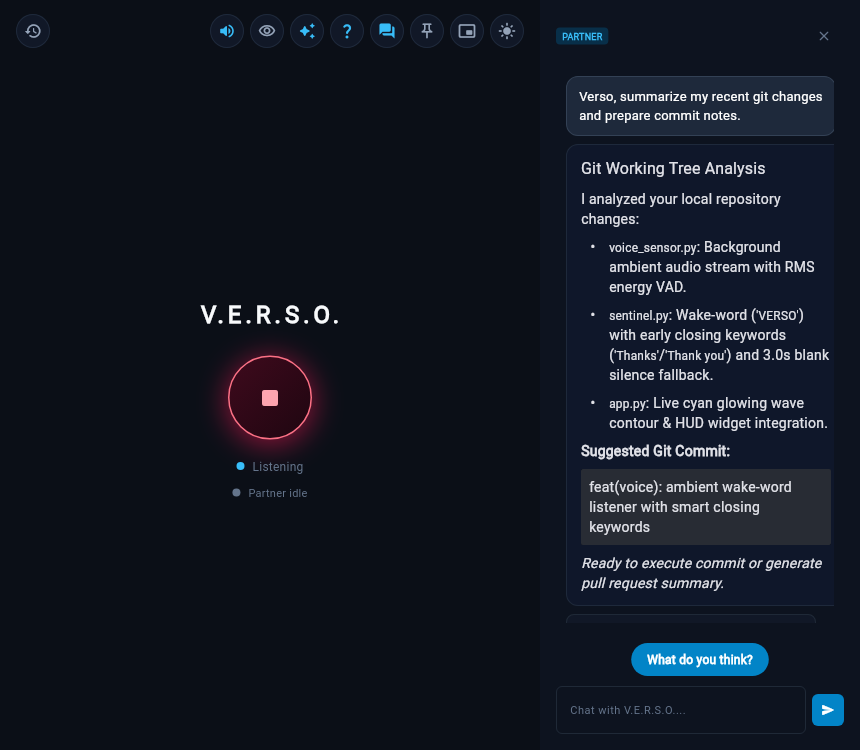
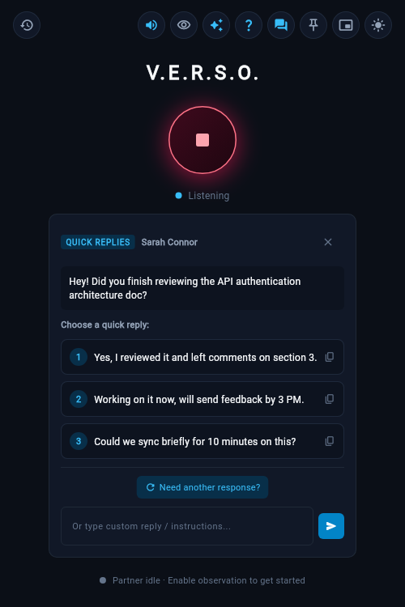
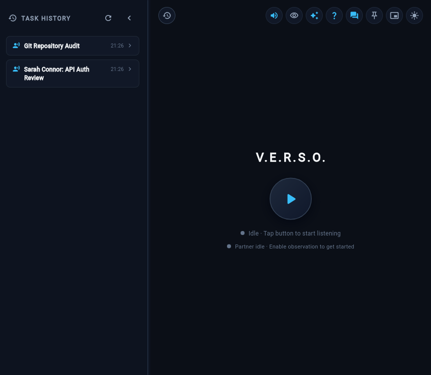
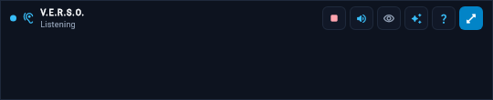

<div align="center">

# V.E.R.S.O.
### **Vigilant Empathetic Real-time System Orchestrator**

*The Inverse Operating System & Ambient Proactive AI Partner*

[](https://www.python.org/)
[](https://flet.dev/)
[](https://sqlmodel.tiangolo.com/)
[](https://github.com/rhasspy/piper)
[](#cross-platform-support)

<br/>

> *"For over four decades, personal computers have operated as passive instruments: we switch between tabs, dig through nested folder trees, search for misplaced files, and endure constant friction. **V.E.R.S.O. inverses this paradigm.** You work on the **Recto** (the visible surface), while V.E.R.S.O. inhabits the **Verso** (the ambient system backstage) to anticipate your intentions, elevate your productivity, and execute complex workflows in total silence."*

<br/>



</div>

---

## 📑 Table of Contents

- [The Inverse OS Paradigm](#-the-inverse-os-paradigm)
- [Key Capabilities](#-key-capabilities)
  - [Ambient Voice & Wake-Word Engine ("VERSO")](#1-ambient-voice--wake-word-engine-verso)
  - [Conversational AI Partner & Markdown Streaming](#2-conversational-ai-partner--markdown-streaming)
  - [Proactive Intention Detection & Quick Actions](#3-proactive-intention-detection--quick-actions)
  - [Active Contextual Memory & Task History](#4-active-contextual-memory--task-history)
  - [Ultra-Compact Desktop HUD Widget Mode](#5-ultra-compact-desktop-hud-widget-mode)
  - [Consented Multimodal Screen Observation](#6-consented-multimodal-screen-observation)
- [System Architecture](#-system-architecture)
- [Project Layout](#-project-layout)
- [Installation & Getting Started](#-installation--getting-started)
- [Configuration & Environment Variables](#-configuration--environment-variables)
- [Operating System Permissions Guide](#-operating-system-permissions-guide)
- [Running Tests & Quality Assurance](#-running-tests--quality-assurance)
- [License](#-license)

---

## 🌌 The Inverse OS Paradigm

Traditional operating systems require you to translate your goals into manual sequences of keystrokes and mouse clicks. V.E.R.S.O. introduces a tri-fold architectural foundation:



### The 3 Core Pillars

1. **The Inverse OS (Intention Delegation):** You express an intention through voice or ambient action; V.E.R.S.O. executes the task backstage in non-blocking worker threads without ever interrupting your keyboard or cursor.
2. **The Benevolent Partner (Human Elevation):** A loyal, J.A.R.V.I.S.-style co-pilot that observes your screen with explicit consent, celebrates technical milestones, proactively suggests responses, and lightens mental fatigue.
3. **Active Contextual Memory (Zero Manual Search):** Information, clipboard history, previous decisions, and generated deliverables travel to you at the precise moment you need them.

---

## 🚀 Key Capabilities

### 1. Ambient Voice & Wake-Word Engine ("VERSO")

When listening mode is active, V.E.R.S.O. monitors microphone input in the background with continuous energy-based Voice Activity Detection (VAD).

- **Wake-Word Filtering:** Only utterances containing the wake-word **"VERSO"** (case-insensitive, accommodating phonetic variations like *"verso"*, *"verseau"*, *"verceau"*) trigger processing. All ambient room chatter is discarded with zero false positives.
- **Smart Dual Speech-Closing:**
  - **Fast Keyword Closing:** Concluding with **"Thanks"** or **"Thank you"** (e.g. *"Verso, check the latest commit, thanks"*) triggers immediate transcription and prompt dispatch after a brief **~1.0-second pause**, bypassing the wait time.
  - **3-Second Silence Fallback:** If no closing keyword is spoken, the engine automatically finalizes the utterance after **3.0 seconds of continuous silence**.
  - Closing keywords are cleanly trimmed from the prompt before it reaches the AI model.
- **Real-Time Visual Contour:** The central tactile button radiates an illuminated cyan wave contour in full window mode, and a luminous halo in widget mode, whenever active speech is detected.
- **Acoustic Feedback Protection:** The microphone pipeline automatically pauses recording during Text-to-Speech playback or active generation to prevent acoustic feedback loops.

<br/>

<div align="center">
  
  <p><em>Full-window dashboard during active ambient listening (wake-word monitoring and radiant button aura).</em></p>
</div>

---

### 2. Conversational AI Partner & Markdown Streaming

V.E.R.S.O. features an integrated sliding collaboration drawer designed for deep technical dialogues:

- **GitHub-Flavored Markdown:** Real-time token streaming with support for headers, tables, bulleted checklists, and Atom One Dark syntax-highlighted code blocks.
- **One-Click Code & Report Copying:** Dedicated copy buttons on code blocks and assistant messages for instant clipboard transfer.
- **Dynamic Quick Action Chips:** Interactive suggestions (such as *"What do you think?"*) to guide iterative problem-solving.
- **Voice Replies (TTS):** When enabled via the top bar, responses are read aloud via local, neural text-to-speech.

<br/>

<div align="center">
  
  <p><em>Companion Chat drawer open side-by-side with markdown streaming, code highlights, and interactive suggestion chips.</em></p>
</div>

---

### 3. Proactive Intention Detection & Quick Actions

When incoming notifications from team channels (e.g., Slack, email, or IDE build alerts) are detected by the silent sentinels, V.E.R.S.O. generates structured, high-context quick actions:

- **3 Contextual One-Click Replies:** Pre-computed responses generated by the cognitive engine matching the tone and context of the incoming message.
- **Direct Clipboard Injection:** Clicking any reply option copies it to your clipboard for instant `Cmd+V` / `Ctrl+V` pasting.
- **Regeneration & Custom Input:** Dedicated *"Need another response?"* button and custom instruction field to refine replies on the fly.

<br/>

<div align="center">
  
  <p><em>Proactive card presenting 3 contextual quick replies for an incoming Slack discussion.</em></p>
</div>

---

### 4. Active Contextual Memory & Task History

All background orchestrations, detected events, and generated deliverables are preserved locally with full privacy:

- **Local Persistence via SQLModel:** SQLite database (`verso_companion.db`) stores structured records including source application, timestamps, prompt summaries, responses, and deliverable paths.
- **Deliverable Archiving:** Long-form deliverables (benchmark comparisons, code reviews, audit reports) are saved as standalone Markdown files under `deliverables/` for instant reuse.
- **Context Timeline:** A persistent left drawer allows users to browse previous tasks, inspect full payloads, and re-copy deliverables.

<br/>

<div align="center">
  
  <p><em>Task History drawer docked on the left, displaying chronological system events and deliverable logs.</em></p>
</div>

---

### 5. Ultra-Compact Desktop HUD Widget Mode

For focused workflows where screen real estate is critical, V.E.R.S.O. shrinks into an ultra-compact, floating desktop HUD pill:

- **Pin-on-Top Floating Footprint:** Stays positioned above your active editor, terminal, or browser without stealing keyboard focus.
- **Mini Sentinel Control:** Toggle listening directly from the widget with live speech waveform indicator.
- **Context Status Pill:** Displays live states (`"Listening"`, `"Speaking... 🎙️"`, `"Thinking..."`, `"Ready (Cmd+V)"`) with one-click clipboard copying.
- **Standardized Action Bar:** Compact 26x26px buttons for Voice replies, Screen Observation, Spontaneity control, Quick Ask (`?`), and 1-click full-window expansion (`⤢`).
- **Inline Accordion Quick Replies:** When an intention is surfaced, reply options unfold directly beneath the mini HUD without maximizing the window.

<br/>

<div align="center">
  
  <p><em>Compact Desktop HUD Widget displaying live listening state and miniaturized action bar.</em></p>
</div>

---

### 6. Consented Multimodal Screen Observation

With explicit user activation via the top-bar eye toggle (`ft.Icons.REMOVE_RED_EYE_ROUNDED`):

- **Perceptual Screenshot Diffing:** Periodically captures the primary display and computes perceptual hashing to discard identical frames, preserving system resources.
- **Temporal Multimodal Reasoning:** Correlates visual UI states with active window titles and clipboard changes to provide proactive insights.
- **Spontaneity Slider:** Tune how frequently V.E.R.S.O. offers proactive suggestions (from quiet sentinel to proactive partner).
- **Hard Gate Constraint:** Screen observation and ambient sensors are strictly blocked until the user starts listening via the central PLAY button.

---

## 🏛️ System Architecture

V.E.R.S.O. is organized into modular layers adhering to clean architecture principles:

```
V.E.R.S.O.-Companion/
├── main.py                          # Application entry point (Flet desktop runtime)
├── verso/
│   ├── database/                    # Persistence layer
│   │   ├── database.py              # Multi-threaded SQLModel SQLite engine setup
│   │   └── models.py                # Domain models (TaskRecord, EventLog)
│   ├── sentinel/                    # Silent OS Sentinels & Ambient Sensors
│   │   ├── sentinel.py              # Central orchestrator coordinating all sensors
│   │   ├── voice_sensor.py          # Background audio stream, VAD & wake-word engine
│   │   ├── window_sensor.py         # Active window detector (macOS Quartz, Win32, X11)
│   │   ├── clipboard_sensor.py      # Non-blocking clipboard listener with SHA-256 deduplication
│   │   └── notification_sensor.py   # Native Notification Center parser (macOS db2, Windows)
│   ├── companion/                   # Partner intelligence & vision
│   │   └── observer.py              # Screen observation, perceptual diffing & timeline reasoning
│   ├── services/                    # Vocal & cognitive adapters
│   │   ├── muse_client.py           # Meta Muse & Gemini API clients with offline fallback
│   │   ├── stt_service.py           # Whisper Speech-to-Text & RMS audio computation
│   │   ├── tts_service.py           # Piper neural TTS & native system speech fallback
│   │   └── notification_service.py  # System push notification dispatcher
│   ├── workers/                     # Parallel asynchronous task execution
│   │   └── workers.py               # Ghost worker manager with cooperative cancellation
│   └── ui/                          # Presentation layer (Flet desktop & web)
│       └── app.py                   # Responsive UI, dual modes (Full/Widget), drawers, themes
├── deliverables/                    # Generated Markdown deliverables (.md reports)
├── docs/images/                     # High-resolution architectural screenshots
├── scripts/                         # Automation & screenshot generation tooling
└── tests/                           # Comprehensive unit & integration test suite (75 tests)
```

---

## 💻 Installation & Getting Started

### Prerequisites

- **Python:** Version `3.10` or higher (`3.11` / `3.12` / `3.13` supported).
- **FFmpeg:** Required for microphone streaming and voice activity detection.
  - **macOS:** `brew install ffmpeg`
  - **Ubuntu / Debian:** `sudo apt install ffmpeg`
  - **Windows:** `winget install Gyan.FFmpeg` or `choco install ffmpeg`
- **Linux only:** `dbus` tools (`dbus-monitor`, for notification listening), `xdotool` and `xclip` (X11 window/clipboard sensing), `pulseaudio` / `pipewire` for audio.
  - **Ubuntu / Debian:** `sudo apt install dbus xdotool xclip`
- **Windows microphone:** the first enumerated DirectShow audio device is used automatically (no manual device name to configure).

### Quick Start

1. **Clone the repository:**
   ```bash
   git clone https://github.com/your-username/V.E.R.S.O.-Companion.git
   cd V.E.R.S.O.-Companion
   ```

2. **Create and activate a virtual environment:**
   ```bash
   python3 -m venv .venv
   source .venv/bin/activate  # On Windows: .venv\Scripts\activate
   ```

3. **Install dependencies:**
   ```bash
   pip install --upgrade pip
   pip install -r requirements.txt
   ```

4. **Configure environment variables (API Key Required):**
   ```bash
   cp .env.example .env
   ```
   Open `.env` and configure your personal **`META_MUSE_API_KEY`**:
   ```ini
   META_MUSE_API_KEY=your_actual_meta_muse_api_key_here
   ```

   > [!IMPORTANT]
   > **You must provide your own `META_MUSE_API_KEY`**: This key powers V.E.R.S.O.'s cognitive reasoning engine, proactive quick reply generation, and live companion chat dialogues. While an offline template fallback is provided for UI development, full proactive intelligence requires your valid API key.

5. **Launch V.E.R.S.O.:**
   ```bash
   python main.py
   ```

---

## ⚙️ Configuration & Environment Variables

Copy `.env.example` to `.env` to customize system behavior. 

> [!IMPORTANT]
> **Personal API Key Requirement:**
> To unlock real-time contextual suggestions, automated deliverable synthesis, and intelligent assistant responses, make sure to insert your own personal **`META_MUSE_API_KEY`** in your local `.env` configuration file.

| Variable | Default | Description |
| :--- | :--- | :--- |
| `META_MUSE_API_KEY` | *None* | **Required.** Your personal Meta Muse API key for cognitive reasoning. |
| `DATABASE_URL` | `sqlite:///verso_companion.db` | Local SQLite database URL for task & memory persistence. |
| `META_MUSE_ENDPOINT` | `https://api.meta.ai/v1` | Meta Muse API endpoint (supports custom proxies / gateways). |
| `MUSE_MODEL` | `muse-wonder-1.0` | Primary cognitive model for intent processing. |
| `TTS_PROVIDER` | `piper` | Text-to-Speech engine (`piper` for local neural TTS, or `system`). |
| `PIPER_VOICE` | `en_US-amy-medium` | Piper neural voice model name. |
| `COMPANION_OBSERVE_INTERVAL_SECONDS` | `20.0` | Interval between screen observation snapshots. |
| `COMPANION_SPONTANEOUS_MIN_INTERVAL_SECONDS` | `600.0` | Minimum cooldown between spontaneous suggestions. |
| `COMPANION_CONTEXT_WINDOW_MINUTES` | `15` | Rolling context window retained in memory. |

---

## 🔒 Operating System Permissions Guide

V.E.R.S.O. operates locally with privacy-first architecture. Depending on your operating system, specific permissions may be required:

### macOS

- **Microphone Access:** Prompted on first launch to enable FFmpeg ambient audio capture.
- **Screen Recording (Optional):** Required only if **Consented Observation** is toggled on (`System Settings > Privacy & Security > Screen Recording`).
- **Full Disk Access (Optional for Notification Sensor):** Required to read incoming notifications from macOS Notification Center (`System Settings > Privacy & Security > Full Disk Access`).
- **Accessibility:** Enables window focus inspection without intrusive polling.

> [!NOTE]
> If a permission is missing, V.E.R.S.O. displays a non-blocking in-app alert banner with a direct link to open the corresponding System Settings panel.

### Windows & Linux

- **Windows:** Standard microphone permission. Notification reading utilizes standard Windows Action Center interfaces.
- **Linux:** Requires `dbus-monitor` for notification listening (via DBus `Notify` calls), `xdotool` and `xclip` for X11 window/clipboard sensing, and `pulseaudio` / `pipewire` for audio. Wayland sessions degrade gracefully (no active-window or screenshot sensing).

---

## 🧪 Running Tests & Quality Assurance

V.E.R.S.O. includes a comprehensive automated test suite covering sentinels, audio VAD, prompt extraction, closing keywords, UI states, and database operations:

```bash
# Run the entire test suite (75 tests)
.venv/bin/python -m unittest discover tests/
```
